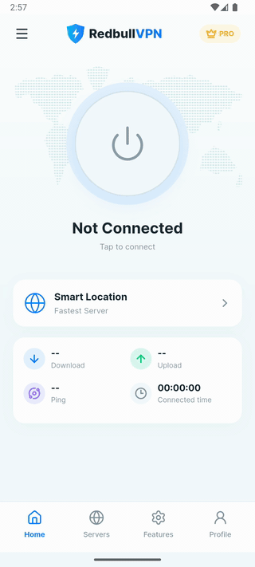

# RedbullVPN — Flutter UI

A VPN app UI built in Flutter from an eight-screen Figma design. It matches the design closely in layout, typography, colour and motion. Every screen has widget tests that check the layout against Figma's coordinates.

> **UI only.** There is no VPN backend. Connecting, the server list, the speeds and the feature switches are all app state for showing the interface.

<p align="center">
  
</p>

## Screens

| # | Screen | What it shows |
|---|---|---|
| 1 | Splash | Animated shield, ripples and loading bar, reproduced from the Figma Motion timeline |
| 2 | Home · Not connected | Power button, world map, Smart Location card, connection stats |
| 3 | Home · Connected | Green ring with sparks and a ripple, stats counting up, the selected server, Disconnect |
| 4 | Choose server | Category tabs, country flags, signal strength, latency, favourites filter |
| 5 | Server details | Location card, ping and speeds, Connect, other servers in the same country |
| 6 | Features | Kill Switch, Split Tunneling, Ad Blocker, DNS Leak Protection, Auto Connect, Protocol |
| 7 | Profile and settings | Pro upgrade card, account menu, Log Out |
| 8 | Navigation drawer | Brand header, upgrade promotion, main destinations |

## Highlights

- **Matches the design closely.** Colours, text styles, spacing and radii are taken from the Figma file. Each screen has a widget test that renders it at 390 × 844 and checks key positions against Figma, to within 1.5 px.
- **Motion.** The splash replays Figma's keyframes. Connecting lights the ring, adds sparks and a ripple, and counts the stats up. Screens fade in once on entry, and lists reveal row by row. Most of this uses [`flutter_animate`](https://pub.dev/packages/flutter_animate).
- **Every country.** Country names come from [`country_code_picker`](https://pub.dev/packages/country_code_picker) and round vector flags from [`circle_flags`](https://pub.dev/packages/circle_flags). No flag images are copied out of Figma.
- **Sharp icons.** One SVG per icon. A custom loader keeps the stroke at Figma's 1.9 px however large the icon is drawn.
- **Scales to any screen.** Sizes scale from the 390 × 844 design with [`flutter_screenutil`](https://pub.dev/packages/flutter_screenutil).

## Architecture

```
lib/
├── core/
│   ├── router/      # go_router config + AppShell (bottom nav and drawer)
│   ├── theme/       # AppColors, AppTextStyles, AppSpacing / AppRadius / AppShadows, AppTheme
│   ├── utils/       # countryName() — English country names
│   └── widgets/     # AppIcon, PageHeader, MenuTile, CountryFlag, BrandLogo, AppBottomNav, …
├── features/
│   ├── splash/      # presentation/
│   ├── home/        # presentation/, providers/ (connection state)
│   ├── servers/     # data/ (server catalogue), providers/ (selection, favourites), presentation/
│   ├── features/    # presentation/
│   ├── profile/     # presentation/
│   └── drawer/      # presentation/
└── gen/             # flutter_gen asset accessors (generated)
```

- **Feature folders.** Each feature keeps its screens and widgets in `presentation/`. A widget moves to `core/widgets/` once two features use it.
- **Navigation.** [`go_router`](https://pub.dev/packages/go_router) with a `StatefulShellRoute`:
  - Home, Features and Profile are tabs inside one shell that owns the bottom nav and the drawer. Each tab keeps its state when you switch away.
  - Choose server and Server details open on top of the shell, with back buttons.
- **State.**
  - State used only inside one screen (tabs, switches, animation triggers) lives in [`flutter_hooks`](https://pub.dev/packages/flutter_hooks).
  - State several screens share lives in [Riverpod](https://riverpod.dev) `Notifier`s: whether you're connected, the selected server and the favourites.
- **Theme.** All colours, text styles, spacing, radii and shadows come from `core/theme/`, with no hard-coded values. Inter is bundled with the app.
- **Assets.** Paths come only from the code [`flutter_gen`](https://pub.dev/packages/flutter_gen) generates (`Assets.svg.*`), never from hand-written strings.

`docs/decisions.md` records the project's conventions. `docs/progress.md` tracks the build screen by screen.

## Getting started

Requires the Flutter SDK (Dart `^3.13.2`).

```bash
flutter pub get
dart run build_runner build --delete-conflicting-outputs   # asset accessors in lib/gen/
flutter run
```

Checks:

```bash
flutter analyze
flutter test
```

## Tech stack

Flutter · go_router · hooks_riverpod · flutter_hooks · flutter_animate · flutter_svg · flutter_gen · flutter_screenutil · country_code_picker · circle_flags
